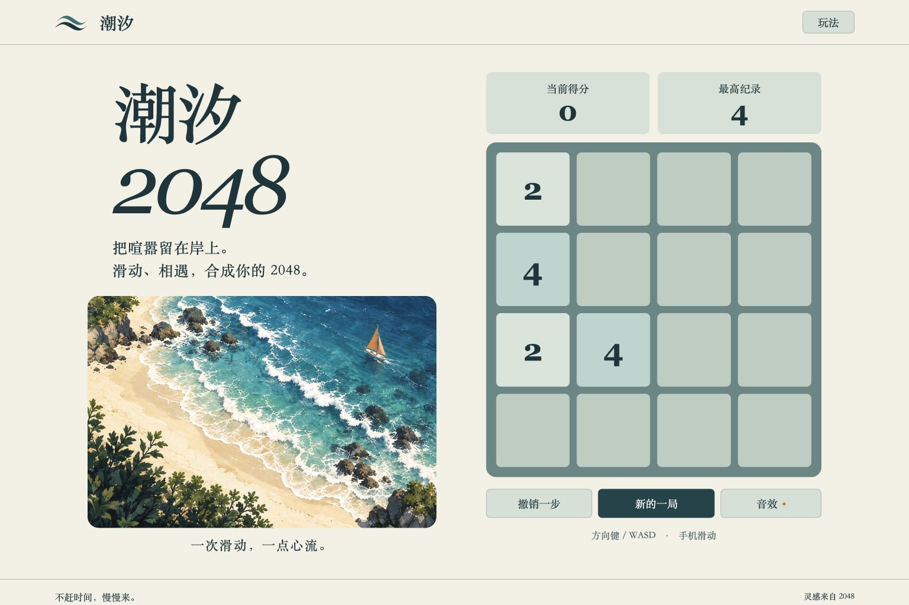
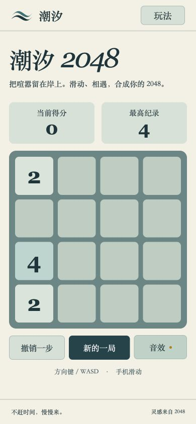

# 潮汐 2048

[在线游玩 (GitHub Pages)](https://EgoistInory.github.io/tide-2048/)

一款中文海岸主题的数字合成小游戏 Demo。采用原生 HTML、CSS、JavaScript 开发，无构建步骤，无第三方运行时依赖，打开浏览器即可体验。

## 游戏预览

<p align="center">
  
</p>
<p align="center">
  
</p>

## 如何运行

本项目无需安装任何依赖，直接用浏览器打开 `index.html` 即可畅玩。

为了获得更稳定的浏览器本地存储（存档）体验，推荐在本地启动一个 HTTP 服务：

```sh
# 使用 Python 自带的 HTTP 服务
python3 -m http.server 4188 --bind 127.0.0.1
```

随后在浏览器中访问 http://127.0.0.1:4188 即可。

## 游戏操作与规则

- **移动方块**：使用键盘方向键 / `WASD`，或在棋盘上用鼠标拖动/手机滑动。
- **合成规则**：每次移动后会随机出现数字 2（90%概率）或 4（10%概率）。将相同的数字碰撞在一起，它们将合并成总和。
- **胜利条件**：合成 `2048` 方块即刻获胜，获胜后可选择继续挑战更高分数！
- **撤销机制**：提供撤销最近一次有效移动的功能，手滑也不怕。
- **自动存档**：当前游戏进度、最高纪录、音效设置等都会自动保存在浏览器中（本地存储），下次打开自动继续。

## 项目结构

作为一个轻量级的 Web 游戏 Demo，本项目结构十分简洁：
- `engine.js`：核心逻辑引擎，纯粹的规则、滑动识别和存档校验。独立于 DOM，方便编写单元测试。
- `app.js`：前端交互层，负责 UI 渲染、动画控制、输入事件处理及音效播放。
- `styles.css`：响应式样式设计，适配桌面端与移动端。
- `assets/`：游戏素材，包括海岸插画 (`coast.png`) 与波浪图标 (`wave.svg`)。
- `tests/`：引擎层面的自动化测试脚本。
- `docs/`：包含设计记录 (`DESIGN.md`) 和验收标准 (`VERIFICATION.md`)。

## 测试与验证

本项目包含了自动化测试与手动验证页面：

```sh
# 运行引擎逻辑测试
node --test tests/engine.test.js
# 语法检查
node --check app.js
```

另外，可以通过浏览器访问 `/tests/scenarios.html`，这是专门用于复现获胜、失败和存档异常等边界场景的沙盒页面。测试使用隔离内存，不会覆盖您的真实游戏存档。

## 致谢

- 核心玩法灵感来源于 [Gabriele Cirulli 的开源项目 2048](https://github.com/gabrielecirulli/2048)。
- 概念图与海岸素材采用 AI 图像生成工具制作，相关提示词可见 `docs/DESIGN.md`。

---
*不赶时间，慢慢来。一次滑动，一点心流。*
